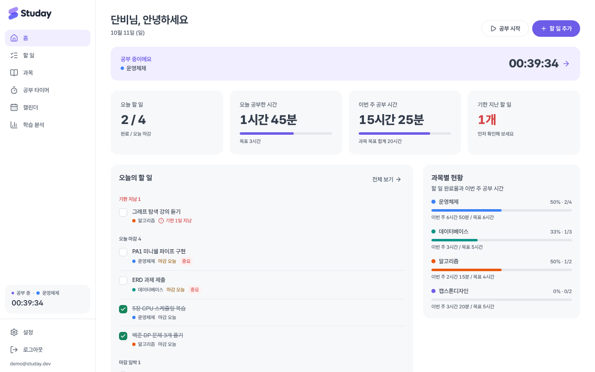
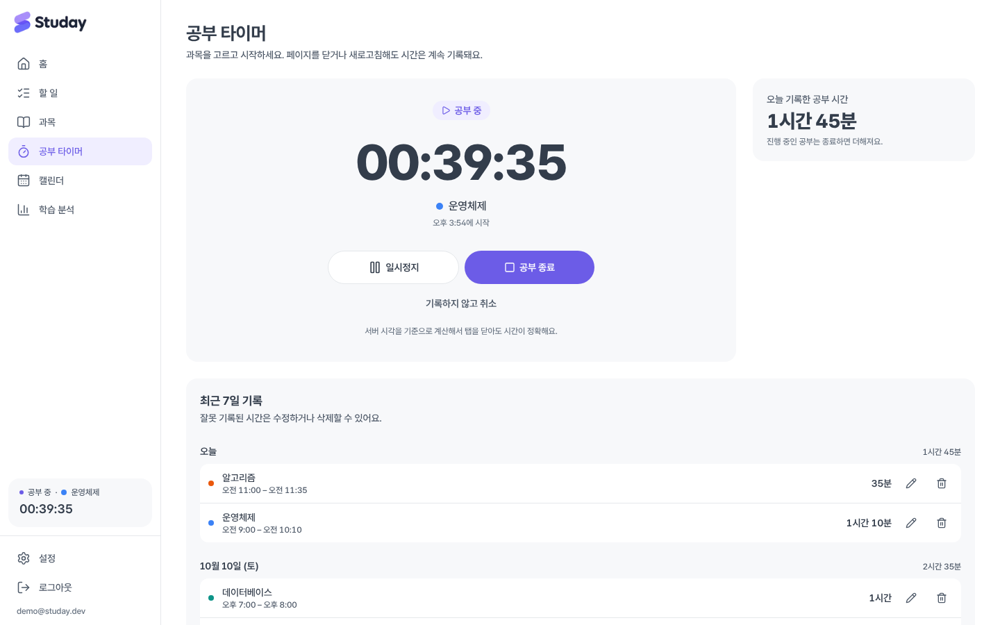
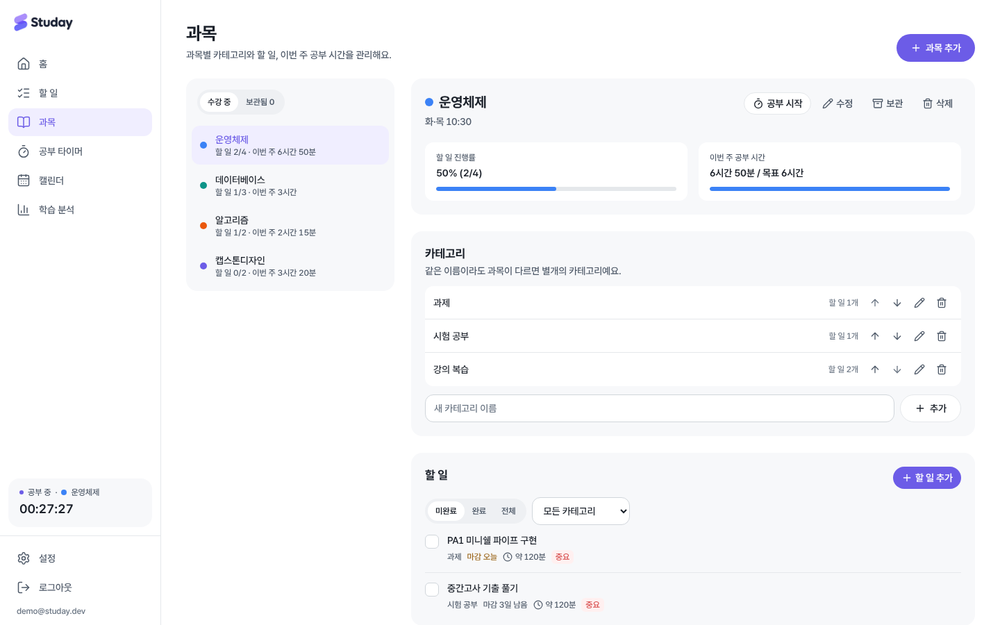
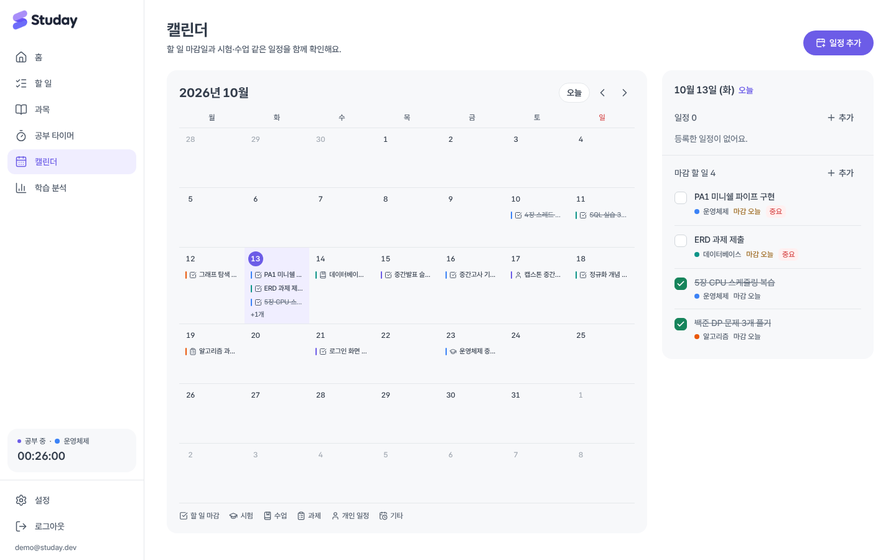
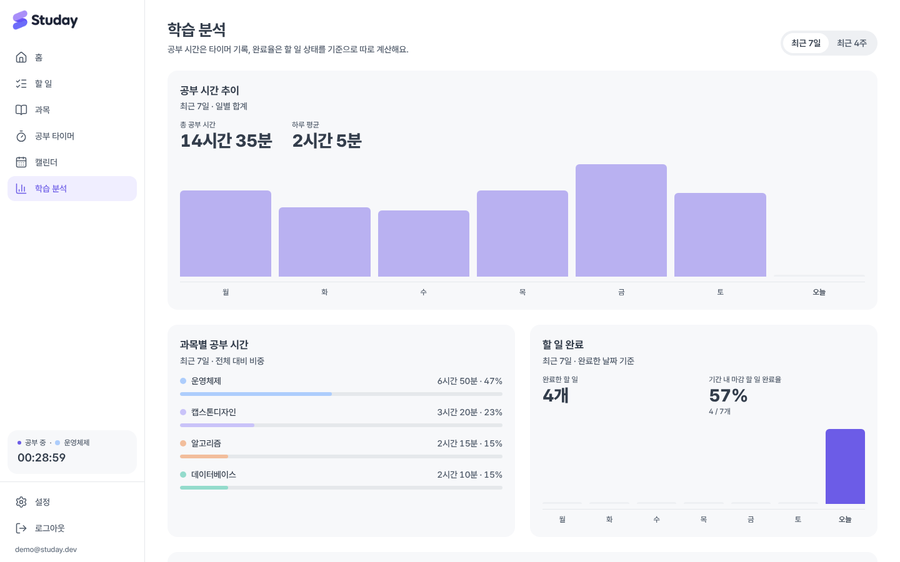

<p align="center"></p>

# studay

**대학생을 위한 개인 학습 플래너.** 과목별 할 일, 공부 타이머, 캘린더, 학습 통계를 한 화면 흐름으로 연결합니다.

`과목 등록 → 할 일·일정 배치 → 타이머로 공부 → 기록이 자동 집계 → 대시보드·캘린더·분석에서 확인`

**서비스 바로가기 → [studay-three.vercel.app](https://studay-three.vercel.app/)**



<sub>스크린샷은 예시 데이터로 촬영했습니다.</sub>

---

## 주요 기능

### 공부 타이머

과목(선택적으로 할 일)을 고르고 시작·일시정지·재개·종료합니다. 새로고침하거나 탭을 닫았다 열어도, 노트북이 잠들었다 깨어나도 시간이 정확하게 이어집니다. 진행 중인 타이머는 사이드바와 브라우저 탭 제목에 항상 표시되고, 잘못 기록된 시간은 나중에 수정하거나 삭제할 수 있습니다.



### 과목·카테고리·할 일

과목마다 색상과 주간 목표 시간을 정하고, 과제·시험 공부·강의 복습 같은 카테고리로 할 일을 나눕니다. 할 일에는 우선순위, 마감일, 예상 소요 시간, 메모를 붙일 수 있고, 마감일이 빠른 순 → 우선순위 순으로 정렬됩니다. 과목 순서는 손잡이를 끌어 바꿀 수 있고(키보드로도 가능), 바꾼 순서는 대시보드와 선택 목록에도 똑같이 적용됩니다. 학기가 끝난 과목은 기록을 남긴 채 **보관**할 수 있습니다.



### 캘린더

할 일 마감일과 시험·수업·과제·개인 일정을 월간 보기로 함께 확인합니다. 색상뿐 아니라 아이콘으로도 종류를 구분하고, 날짜를 누르면 그날의 일정과 할 일을 바로 처리할 수 있습니다.



### 대시보드·학습 분석

오늘 할 일과 기한 지난 할 일, 오늘·이번 주 공부 시간과 목표 달성률, 과목별 현황을 한눈에 봅니다. 학습 분석에서는 최근 7일·4주의 공부 시간 추이, 과목별 비중, 할 일 완료 수와 마감 완료율을 확인합니다. 공부 시간은 타이머 기록으로, 완료율은 할 일 상태로 따로 계산합니다.



### 계정

로그인 없이 홈 화면을 먼저 둘러볼 수 있고, 할 일 추가나 다른 화면으로 이동하려고 하면 로그인하게 돼요. 로그인은 Google 계정으로만 해요(가짜 이메일 가입 방지, 비밀번호 관리 불필요). 시간대, 일일 목표, 한 주의 시작 요일을 설정할 수 있습니다.

---

## 설계 포인트

**공부 시간이 정확하고 중복되지 않습니다**

- 브라우저에서 1초씩 더하는 방식이 아니라, DB에 저장된 "중단 없이 공부한 구간"(`study_segments`)의 시작·종료 시각으로 계산합니다. 서버 시계와의 차이도 보정합니다.
- 시작·일시정지·재개·종료는 DB 함수로만 처리하고, 브라우저가 시간 값을 직접 쓸 수 없게 권한을 막았습니다.
- 진행 중 타이머는 사용자당 1개만 존재하도록 DB가 보장합니다(동시에 두 번 눌러도 하나만 생성). 종료 요청이 중복돼도 한 번만 집계되고, 다른 기록과 겹치는 시간 수정은 거부됩니다.
- 자정을 넘긴 공부는 사용자 시간대(기본 Asia/Seoul) 기준으로 날짜별로 나눠 집계합니다.

**내 데이터는 나만 봅니다**

- 모든 테이블에 Row Level Security를 적용해 본인 데이터만 조회·수정할 수 있습니다. 로그인하지 않은 요청은 어떤 테이블에도 접근할 수 없습니다.
- 복합 외래 키로 "할 일의 카테고리는 같은 과목 소속", "다른 사람의 과목에 할 일을 연결할 수 없음"을 DB에서 강제합니다.
- 다른 계정으로 로그인하면 화면 캐시를 비워 이전 사용자의 데이터가 보이지 않습니다.

**하나의 원본에서 파생합니다**

- 캘린더의 할 일 마감일은 할 일 데이터에서 바로 표시하고, 일정 테이블에 복사하지 않습니다.
- 전체·과목별·일별 공부 시간은 모두 같은 구간 데이터에서 계산합니다.

---

## 기술 스택

| 영역        | 사용 기술                                                    |
| ----------- | ------------------------------------------------------------ |
| 프론트엔드  | Next.js 16 (App Router), React 19, TypeScript                |
| 스타일      | Tailwind CSS 4, Pretendard, Lucide 아이콘                    |
| 데이터·인증 | Supabase (PostgreSQL, Auth, Row Level Security), SWR         |
| 배포        | Vercel (프론트·서버 기능), GitHub Actions (CI)               |
| 테스트      | Vitest (단위), Node + PostgreSQL (DB 통합), Playwright (E2E) |

별도 서버를 상시 실행하지 않습니다. 서버 쪽 처리는 Vercel의 Next.js 기능(프록시, 라우트 핸들러)과 Supabase가 담당합니다.

---

## 실행과 배포

- 서비스: [studay-three.vercel.app](https://studay-three.vercel.app/) (Vercel + Supabase)
- 내 컴퓨터에서 실행하기: [CONTRIBUTING.md › 시작하기](CONTRIBUTING.md#0-시작하기)
- 직접 배포하거나 인증 설정 바꾸기: [배포 가이드](docs/deployment.md)

---

## 개발

### 명령

| 명령              | 내용                                                         |
| ----------------- | ------------------------------------------------------------ |
| `npm run dev`     | 개발 서버                                                    |
| `npm run check`   | 타입 검사 + ESLint + Prettier 검사 + 단위 테스트             |
| `npm run test:db` | DB 통합 테스트 (일회용 PostgreSQL 필요, `TEST_DATABASE_URL`) |
| `npm run build`   | 프로덕션 빌드                                                |

`npm run test:db`는 지정한 PostgreSQL에 임시 DB를 만들어 Supabase 인증 동작을 흉내 낸 뒤 마이그레이션을 적용하고, 두 사용자로 권한과 타이머 함수를 검사한 다음 임시 DB를 지웁니다. **실서비스 DB 주소를 넣지 마세요.** GitHub Actions에서는 PR마다 PostgreSQL 컨테이너로 모든 검사와 빌드를 실행합니다.

| 테스트           | 개수   | 주요 내용                                                                                                                 |
| ---------------- | ------ | ------------------------------------------------------------------------------------------------------------------------- |
| 단위 (Vitest)    | 45     | 시간대·자정 분할·서머타임, 타이머 경과 시간, 정렬·필터·진행률, 집계, 순서 변경, 로그인 후 이동 경로, GA4 이벤트 중복 방지 |
| DB 통합          | 28     | 사용자 간 격리, 비로그인 차단, 관계 무결성, 동시 시작, 중복 종료, 겹치는 시간 수정, 과목 순서, 삭제 정책                  |
| E2E (Playwright) | 29단계 | 로그인 → 과목·할 일 → 타이머 새로고침 복원 → 캘린더 → 분석 → 다른 계정 격리 → 재로그인                                    |

### 브랜치·커밋 규칙

`main`은 항상 배포 가능한 상태로 두고, `feat/…`·`fix/…`·`docs/…` 브랜치에서 작업한 뒤 PR로 병합합니다. 커밋은 Conventional Commits(`feat(timer): 일시정지 구간 기록 추가`)를 따르며, 커밋 훅이 포맷·린트·메시지 규칙을 자동으로 검사합니다. 자세한 내용은 [CONTRIBUTING.md](CONTRIBUTING.md)를 참고하세요.

### 프로젝트 구조

```
src/
├─ app/
│  ├─ (auth)/            시작하기(Google 로그인) 화면, /signup은 /login으로 이동
│  ├─ (app)/             로그인 후 화면 (홈, 할 일, 과목, 타이머, 캘린더, 분석, 설정)
│  └─ auth/callback/     Google 로그인 완료 처리
├─ components/           ui/ 공통 컴포넌트, 그 외 기능별 컴포넌트
├─ lib/
│  ├─ data/              Supabase 조회(queries)·변경(mutations)
│  ├─ supabase/          브라우저·서버용 Supabase 클라이언트
│  ├─ analytics.ts       GA4 이벤트
│  └─ *.ts, *.test.ts    시간·타이머·할 일·통계 순수 로직과 같은 이름의 단위 테스트
├─ test/                 테스트용 데이터 생성 함수
└─ proxy.ts              세션 갱신, 비로그인 접근 차단
supabase/migrations/     DB 스키마·RLS·타이머 함수 (이름 순서대로 적용)
scripts/                 DB 통합 테스트(test-db.mjs)와 Supabase 흉내 SQL
docs/
├─ deployment.md         배포·인증·GA 설정 가이드
├─ analytics.md          GA4 이벤트 명세
├─ design.md             디자인 시스템
├─ requirements/         처음 받은 요구사항 원문
└─ images/               README 스크린샷
```

### 데이터 삭제 정책

| 삭제 대상 | 함께 처리되는 데이터                                                                       |
| --------- | ------------------------------------------------------------------------------------------ |
| 과목      | 카테고리·할 일·공부 기록은 삭제, 일정은 남기고 과목 연결만 해제 (기록을 남기려면 **보관**) |
| 카테고리  | 할 일은 미분류 또는 선택한 다른 카테고리로 이동                                            |
| 할 일     | 공부 기록은 남기고 할 일 연결만 해제                                                       |

---

## 알려진 제한

- 캘린더는 월간 보기만 지원합니다(주간·일간 보기, 반복 일정, 외부 캘린더 연동 없음).
- 여러 날에 걸친 일정은 표시되지만, 입력 폼은 하루 안의 시작·종료 시각만 지원합니다.
- 공부 기록의 시간을 수정하면 그 기록의 일시정지 구간이 하나로 합쳐집니다.
- 오프라인 상태의 타이머 조작은 저장되지 않으며, 실패 시 오류와 다시 시도 버튼을 보여줍니다.
- 비밀번호 재설정, Google 외 소셜 로그인은 아직 없습니다.

## 문서

- [docs/deployment.md](docs/deployment.md) — 배포·인증·Google Analytics 설정 가이드
- [docs/analytics.md](docs/analytics.md) — GA4 이벤트 명세(시점·파라미터·중복 방지)
- [docs/design.md](docs/design.md) — 디자인 시스템
- [docs/requirements/study-space-prompt.md](docs/requirements/study-space-prompt.md) — 제품 요구사항과 수용 기준(원문)
- [docs/requirements/implementation-prompt.md](docs/requirements/implementation-prompt.md) — 구현·검증·배포 지침(원문)
- [AGENTS.md](AGENTS.md) — AI 코딩 에이전트 작업 규칙
- [CONTRIBUTING.md](CONTRIBUTING.md) — 로컬 실행, 브랜치·커밋·코드 컨벤션
